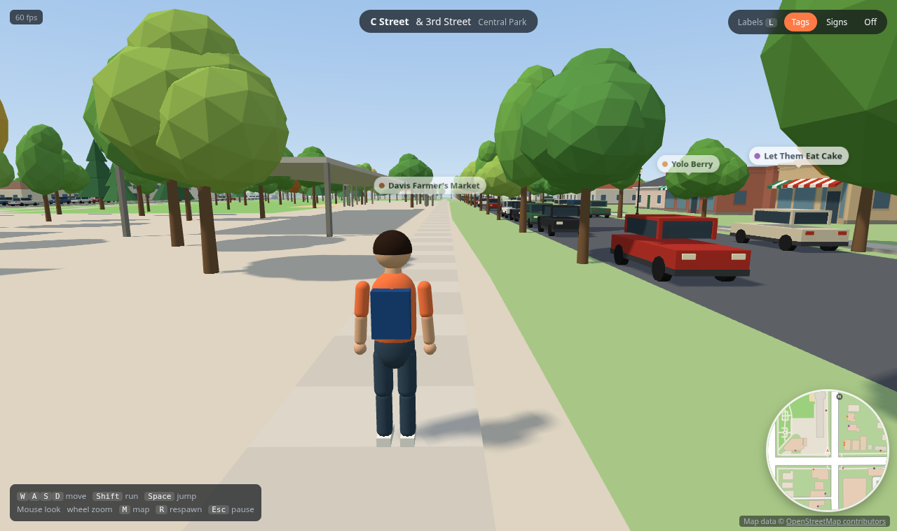
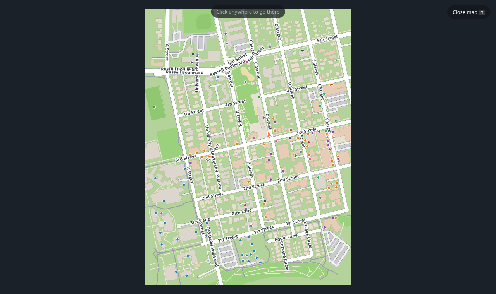

# Open World

An open world of the whole planet, built from real map data and explored on foot in third
person. It starts with one neighborhood: downtown Davis, California. You spawn on C Street
next to Central Park and can walk the real streets, sidewalks and crosswalks between B and C
Streets from 1st to 5th. Every road, building, park and shop comes from
[OpenStreetMap](https://www.openstreetmap.org), so the same approach works for any place on
Earth. The world is generated in the browser in a clean, stylized look.



| Storefront and street signs | Full map with teleport |
| --- | --- |
|  |  |

Where it's going: from one neighborhood to anywhere in the world, streamed in as you move, and
more realistic wherever people contribute real photos and video of places. See
[docs/ROADMAP.md](docs/ROADMAP.md).

## Features

- **Third-person character** with walk, run and jump animations, an over-the-shoulder camera
  that avoids walls, and collision with buildings, trees, lamps and parked cars.
- **Streets from real data**: lanes and center lines, stop lines, mapped crosswalks, raised
  sidewalks with curbs and planting strips, footpaths, bike paths, parks and parking lots.
- **Buildings from real footprints**: heights from OSM where tagged, otherwise estimated by
  building type; houses get hip roofs, shops get storefront windows and awnings.
- **Street life**: trees (mapped and generated along streets), street lamps, benches,
  bike racks, hydrants and parked cars.
- **Real places**: 100+ named businesses and buildings. Switch labels between floating
  tags, physical signs (storefront signs, lawn signs, street-name blades at corners) or off.
  Walk up to a place to see an info card with its address and hours.
- **Navigation**: a rotating minimap, a full map with street names (click to teleport), and
  a live "where am I" bar showing the street, cross street and park.

## Quick start

Requirements: Python 3.9+ and a browser with WebGL 2. There is no build step and nothing to
install.

```bash
python3 server.py
```

Open <http://localhost:8080> and click **Click to play**.

On the first run the server downloads the map data from the public Overpass API, which can
take one to three minutes (the loading bar waits for it). After that, everything is served
from `.cache/` on disk and loads instantly.

The server listens on all interfaces, so other devices on your network or
[Tailscale](https://tailscale.com) tailnet can play at `http://<this-machine's-ip>:8080`.
Set `PORT=9000` to use a different port.

## Controls

| Action | Keys |
| --- | --- |
| Move | `W` `A` `S` `D` or arrow keys |
| Run / jump | `Shift` / `Space` |
| Look | Mouse (or `Q` / `E`); if the mouse can't be captured, click and drag |
| Zoom camera | Mouse wheel |
| Labels: tags → signs → off | `L` |
| Full map (click to teleport) | `M` |
| Respawn at C & 3rd | `R` |
| Pause / release mouse | `Esc` |

## How it works

```
OpenStreetMap (Overpass API)
        │  downloaded once per area
        ▼
server.py ── converts to compact JSON in local meters ── .cache/  (served gzipped)
        │
        ▼
Browser (three.js) ── builds streets, buildings, trees and props from the data on every load
```

The server only downloads, converts and serves data; all geometry is generated in the browser.
See [docs/ARCHITECTURE.md](docs/ARCHITECTURE.md) for the details and
[docs/DATA.md](docs/DATA.md) for the data formats.

## Project layout

```
server.py            HTTP server + OSM download/convert/cache (Python standard library only)
index.html           Page, HUD styles, three.js import map
js/main.js           Boot: renderer, sky/sun, loading, input, HUD, game loop
js/world.js          World model: spatial indexes, collision, curb heights, street lookup
js/streets.js        Ground, parks, roads, markings, crosswalks, sidewalks, furniture spots
js/buildings.js      Building styles, heights, facades, roofs
js/props.js          Trees, lamps, benches, bike racks, hydrants, parked cars (instanced)
js/labels.js         Place labels: floating tags, 3D signs, street signs, info-card lookup
js/minimap.js        Minimap and full map
js/character.js      Procedural stylized character and its animation
js/player.js         Movement, collision response, third-person camera
js/util.js           Geometry helpers, spatial hash, mesh builder
tools/screenshot.py  Headless screenshots for checking visual changes
docs/                Architecture, data formats, roadmap, images
```

## Changing the area

For now the game loads one area at a time, defined by `WORLD` in `server.py`: an `origin` (the
0,0 point of the local coordinate system), a walkable `core` bounding box and a larger,
low-detail `context` box. Any place OpenStreetMap covers works: change those values, restart
the server, and it downloads the new area. The spawn point is chosen in `findSpawn()` in
`js/main.js` (C Street & 3rd Street in Davis) and falls back to the origin elsewhere.

## Contributing

- Read [AGENTS.md](AGENTS.md); it is the short guide for anyone (person or tool) changing the code.
- For visual changes, run `python3 tools/screenshot.py` and look at the images before and
  after your change.

## Credits and license

- Map data © [OpenStreetMap contributors](https://www.openstreetmap.org/copyright), available
  under the Open Database License. The in-game credit line must stay visible.
- Rendering by [three.js](https://threejs.org) (MIT), loaded from unpkg.
- Code is released under the [MIT License](LICENSE).
