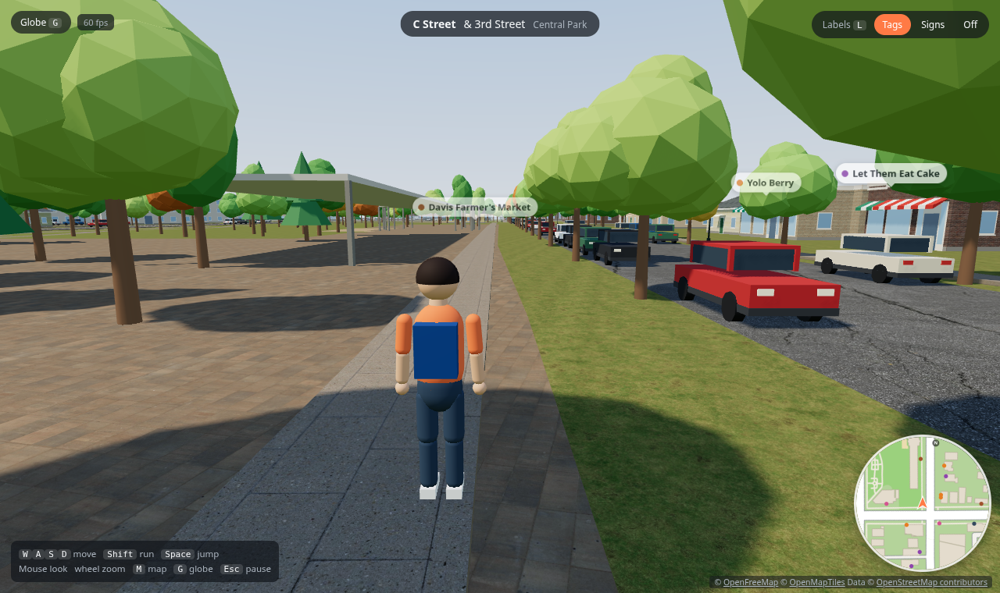
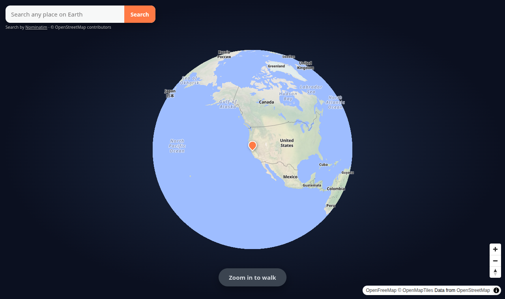
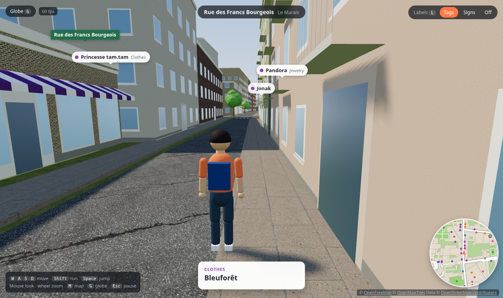
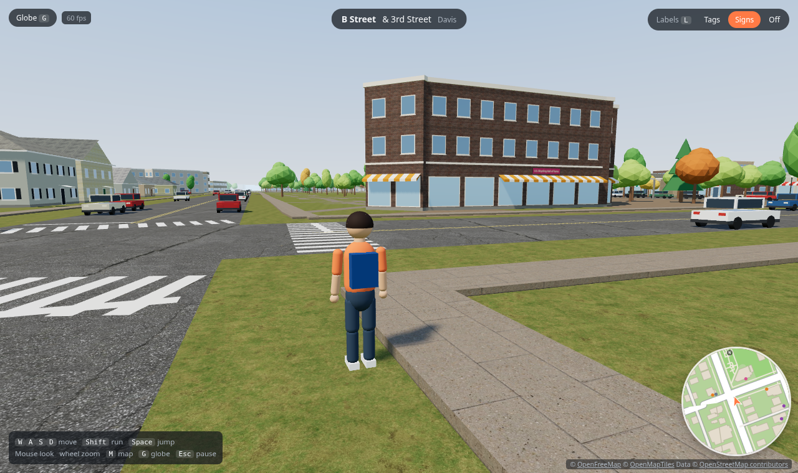

# Open World

An open world of the whole planet, built from real map data and explored on foot in third
person. Spin the globe, search for any place, zoom in to a street and walk it: every road,
building, park and shop comes from [OpenStreetMap](https://www.openstreetmap.org), generated in
the browser with realistic materials. It starts in downtown Davis, California, which has extra
detail.



| Go anywhere from the globe | Paris, Le Marais | Storefront and street signs in Davis |
| --- | --- | --- |
|  |  |  |

Where it's going: more realistic places as people contribute real photos and video, and more
detail everywhere. See [docs/ROADMAP.md](docs/ROADMAP.md).

## Features

- **The whole world.** A 3D globe with place search; zoom in to any street and press
  **Walk here**. Press `G` to fly back out. The world streams in around you as you walk.
  If you share your location, you start on the street where you are.
- **Third-person character**: pick a name and one of four textured characters, with walk, jog, run, sprint
  and jump animations, an over-the-shoulder camera
  that avoids walls, and collision with buildings, trees, lamps and parked cars.
- **Real terrain**: streets, buildings and parks follow the ground, so San Francisco's hills
  climb and Montmartre rises to Sacré-Cœur. Elevation comes from open terrain tiles covering
  the whole planet. Beyond the streets, low-detail land and sea reach out about 20 km, and the
  haze lifts when you're high up, so from a summit you see the landscape and the sunset over the
  water.
- **Streets from real data**: road widths fitted to the buildings around them, cracked asphalt,
  center lines, stop lines, crosswalks, concrete sidewalks with curbs, footpaths, bike paths,
  parks, water, and parking lots with painted stalls.
- **Buildings from real footprints**: real heights and colors where OpenStreetMap has them,
  otherwise styles inferred from what's inside and the surrounding zone. Real materials (siding,
  stucco, brick, concrete, corrugated metal; shingle, clay-tile and gravel roofs), gable and hip
  roofs, porches, shutters, balconies, storefronts and awnings, varied building by building.
- **Real roof colors in the US**: each roof's color is measured from USGS aerial photos.
- **Cars and bikes**: press `V` for your car or `B` for your bike (or tap Car / Bike), `F` to
  get in, and drive with `W` `A` `S` `D`; you can also get into any parked car or a car from
  traffic. Six car models drive differently (a sports hatchback up to 144 km/h, a slow van that
  leans in corners); `V` again next to your car swaps the model. Realistic acceleration, speed
  limits by road type (25 mph on residential streets and 65 mph on highways in the US, km/h
  limits elsewhere) shown next to the speedometer, real hills, collisions, and other players see
  you driving.
- **Traffic**: about 20 cars drive the streets around you, keep their distance, slow down at
  junctions and stop at traffic lights, which cycle where OpenStreetMap maps them (or where
  main roads cross).
- **Driving effects**: hard braking leaves fading tire tracks and smoke on roads, including
  hills and bridge decks. Headlights, street lamps and flashing police lights have soft halos
  that disappear behind buildings. Rain kicks up tire spray, unpaved ground raises dust, and
  impacts throw small sparks. Effects use fixed pools with lower limits on mobile.
- **Car physics**: four tire contacts share grip between braking and cornering; mass, rotational
  inertia, spring/damper suspension and weight transfer produce understeer and oversteer.
  Cars have different front, rear or all-wheel drive, five automatic gears, engine braking,
  drag, and rolling resistance. Hills, rain, snow, dirt and damaged tires change handling.
  The rear handbrake can spin the car; recovery requires easing off or countersteering.
- **Driving feel and sound**: the camera looks slightly ahead, and holding `C` looks behind.
  Engine pitch follows the drivetrain's RPM and tire squeal follows lost grip. Synthesized tire,
  impact, horn (`H`), footstep and rain sounds share the `N` sound toggle. Traffic brakes earlier
  for stopped cars and occasionally honks when blocked, without honking at red lights.
- **Real time and weather**: the sun is where it really is at that place and time (sunsets,
  starry nights with lit windows, street lamps and headlights), and the weather is live from
  Open-Meteo: clouds, rain on wet streets, snow, fog and thunderstorms. `T` and `Y` (or About)
  switch to a fixed time of day or weather.
- **Police chases**: patrol cars notice speeding, red lights, crashes and driving on sidewalks or
  through parks. Escape them and the heat rises: more units, police SUVs, then interceptors and
  roadblocks. Get boxed in and you're busted (your car is impounded); stay out of sight until the
  cooldown fills and you escape. Sirens are made in the browser; `N` mutes them.
- **Other players**: everyone online nearby shows up with their name and character, live. You
  start hidden if you began at your own location; `O` (or the Online button) shows or hides you.
- **Street life**: trees, street lamps, benches, bike racks, hydrants and parked cars, plus a
  small local population of strollers, commuters, walkers and joggers on verified sidewalks
  and paths (up to eight, four on mobile). Four character bases have varied clothing colors,
  proportions, walking speeds and independent animations. Walkers continue around corners,
  keep personal space and react to nearby cars. Nearby water has wind-driven moving reflections.
- **Textured trees**: branching trunks with photographic bark and cutout leaves/needles,
  six broadleaf, columnar and conifer shapes, and wind-driven foliage with matching shadows.
  Distant trees use simpler meshes; phones use a smaller detail radius.
- **Adaptive graphics**: automatic resolution aims for 40+ fps while keeping detailed models,
  textures and shadows. The interface stays sharp. Choose Auto or Full resolution in About;
  actual performance depends on the device and location. Compact scenery buffers, shared
  textures and bounded terrain caches reduce memory use.
- **Real places in any language**: shop, restaurant and building names as floating tags or
  physical signs (`L` switches), an info card when you walk up to a place, and a live
  "where am I" bar with the street, cross street and neighborhood.
- **Photos of real places**: walk up to a landmark and its photos from
  [Wikimedia Commons](https://commons.wikimedia.org) appear on the info card; press `P` (or tap
  the card) to browse them, each with its author and license.
- **Extra detail where it's been built**: selected areas (downtown Davis today) use richer
  OpenStreetMap data with mapped sidewalks, crosswalks, trees, benches and opening hours.

## Quick start

Requirements: Python 3.9+ and a browser with WebGL 2. There is no build step and nothing to
install.

```bash
python3 serve.py
```

Open <http://localhost:8080>. The globe flies to Davis; press **Walk here** (or search for
somewhere else first).

The server only serves files; map data is fetched by the browser and kept in its cache, so
places you've visited load faster next time. The server listens on all interfaces, so other
devices on your network or [Tailscale](https://tailscale.com) tailnet can play at
`http://<this-machine's-ip>:8080`. Set `PORT=9000` to use a different port.

Links: `http://localhost:8080/#48.85745,2.36154` starts walking at that latitude/longitude;
the address bar keeps your current position so you can share it.

## Controls

| Action | Keys |
| --- | --- |
| Move | `W` `A` `S` `D` or arrow keys |
| Run / jump | `Shift` / `Space` |
| Sprint | Tap `Shift` twice and hold |
| Look | Mouse (or `Q` / `E`); if the mouse can't be captured, click and drag |
| Zoom camera | Mouse wheel |
| Labels: tags → signs → off | `L` |
| Photos of the place you're at | `P` |
| About, credits and the GitHub link | `I` (also on the pause screen and the globe) |
| Show or hide yourself to other players | `O` (or the Online button) |
| Your car / your bike (`V` again: another car model) | `V` / `B` |
| Get in or out (also any parked or passing car) | `F` |
| Drive / brake | `W` `A` `S` `D` / `Space` |
| Look behind / horn | Hold `C` / `H` |
| Sound on / off | `N` |
| Time of day: live / day / sunset / night | `T` |
| Weather: live / clear / rain / snow / fog | `Y` |
| Speed in mph / km/h | `U` |
| Map of where you are (pick a spot to walk to) | `M` |
| Fly out to the globe | `G` |
| Respawn where you walked in | `R` |
| Pause / release mouse | `Esc` |

On phones and tablets: the joystick sits in the bottom-left corner (push further to run; hold it
all the way for a moment to lock into a sprint, which keeps going after you let go until you
touch the joystick again), drag anywhere else to look and steer, pinch to zoom, and tap **Jump**.
Left-handed? **About → Joystick: Right** swaps the joystick and Jump.

## How it works

```
Globe (MapLibre + OpenFreeMap) ──"Walk here"──▶ street world at that point
                                                 │
 OpenFreeMap vector tiles (whole planet) ────────┤  browser downloads ~2 km tiles,
 data/detail/*.json (pre-built richer areas) ────┘  cuts them into ~500 m chunks and
                                                    builds streets, buildings and props
                                                    around the player as they move
 Terrain Tiles (elevation PNGs) ──────────────────▶ everything is draped on the ground
```

Everything runs in the browser; `serve.py` is a plain file server. The only server-side piece
is the small multiplayer relay in `relay/`, which passes positions between players. See
[docs/ARCHITECTURE.md](docs/ARCHITECTURE.md) for details and [docs/DATA.md](docs/DATA.md) for
the data formats.

## Project layout

```
index.html              Page, HUD and globe UI, styles, script/import map
js/main.js              Boot, screens (globe/loading/street), input, HUD, game loop, spawning
js/rendering.js         Adaptive graphics resolution and lighting work reduction
js/geometry.js          Compact static scenery through exact shared-vertex indexing
js/globe.js             MapLibre globe, place search and reverse geocoding (Nominatim)
js/materials.js         Shared textured materials (CC0 textures in assets/textures)
js/aerial.js            Roof colors sampled from USGS aerial imagery (US only)
js/geo.js               Web Mercator tiles and the local metric frame around the walk-in point
js/terrain.js           Elevation from Terrain Tiles (Terrarium PNGs), sampled per point
js/farview.js           Distant land and sea out to ~20 km, beyond the streamed streets
js/tiledata.js          Load a tile (vector or detail) and convert it to the common format
js/mvt.js               Minimal Mapbox Vector Tile decoder
js/chunks.js            Streaming: tile prep, clipping into chunks, full/lite builds, unloading
js/clip.js              Polygon and polyline clipping to chunk rectangles
js/world.js             Chunk indexes and world queries: collision, curbs, streets, locations
js/streets.js           Ground, areas, roads, markings, crosswalks, sidewalks, furniture spots
js/buildings.js         Building styles, heights, facades, roofs
js/props.js             Trees, lamps, benches, bike racks, hydrants, parked cars (instanced)
js/trees.js             Shared textured tree geometry, wind and distance detail
js/labels.js            Place labels: floating tags, 3D signs, street signs, info-card lookup
js/photos.js            Photos of places from Wikimedia Commons (matched through Wikidata)
js/minimap.js           Rotating minimap from per-chunk canvases
js/character.js         The player's character (3D models with animations) and its fallback figure
js/profile.js           The player's name and character, kept on the device
js/vehicles.js          Car/bike models, terrain contacts, collision impulses, the rider
js/carphysics.js        Tire forces, suspension, drivetrain, weight transfer and surface grip
js/traffic.js           Traffic cars following the streets, and traffic lights
js/police.js            Police: crimes, wanted level, chases, roadblocks, busted/escaped, siren
js/atmosphere.js        Sun position, sky, clouds, live weather (Open-Meteo), rain/snow, night lights
js/drivingfx.js         Terrain-following tire tracks, smoke and batched light halos
js/soundscape.js        Synthesized engine, tire, impact, horn, footstep and rain audio
js/pedestrians.js       Bounded local walkers on verified sidewalks and footpaths
js/people.js            Deterministic pedestrian appearance and behavior factory
js/limits.js            Speed limits by road class (mph in the US and UK, km/h elsewhere)
js/multiplayer.js       Other players: connection to the relay, their characters and name tags
js/player.js            Movement, collision response, third-person camera
js/touch.js             Touch controls: fixed joystick with sprint lock, look, pinch zoom, Jump
js/util.js              Geometry helpers, spatial hash, mesh builder, time slicing
data/detail/            Pre-built detailed tiles (downtown Davis)
assets/textures/        CC0 material textures (see CREDITS.md there)
assets/characters/      CC0 textured character models and lighter population meshes
assets/nature/          CC0 bark and foliage textures (see CREDITS.md there)
assets/vehicles/        CC0 car models (see CREDITS.md there)
assets/effects/         CC0 smoke texture (see CREDITS.md there)
assets/icons/           App icons (tab, home screen); favicon.ico and site.webmanifest sit at the root
serve.py                Static file server (Python standard library only)
relay/                  Multiplayer relay (Cloudflare Worker + Durable Objects), deployed separately
tools/build_detail.py   Build detailed tiles from OpenStreetMap (Overpass API)
tools/fetch_textures.py Download and prepare the material textures
tools/pack_character.py Pack a character .gltf into a compact .glb with the animations the game uses
tools/screenshot.py     Headless screenshots for checking visual changes
docs/                   Architecture, data formats, roadmap, images
```

## Deploying

It's a static site: any static host works, with no build step. On [Vercel](https://vercel.com),
import the repository with **Framework Preset: Other** and **Root Directory: the repository
root** (Vercel may suggest Python and `tools/` because of the scripts there; don't accept that).
`vercel.json` sets cache headers for textures and map data. Every push to `main` redeploys.
Live: <https://open-world-sigma-two.vercel.app>.

The multiplayer relay runs on Cloudflare (Workers free plan): `cd relay && npx wrangler deploy`.
To test multiplayer locally, run `npx wrangler dev` in `relay/` and open the game with
`?relay=ws://localhost:8787`.

## Adding a detailed area

Detailed tiles come from `tools/build_detail.py`. Add the tile (zoom 14 x/y) to
`DETAIL_TILES` in that file, run `python3 tools/build_detail.py`, and commit the generated
`data/detail/` files. Everywhere else uses the vector tiles automatically.

## Contributing

- Read [AGENTS.md](AGENTS.md); it is the short guide for anyone (person or tool) changing the code.
- For visual changes, run `python3 tools/screenshot.py` and look at the images before and
  after your change.

## Credits and license

- Map data © [OpenStreetMap contributors](https://www.openstreetmap.org/copyright) (ODbL).
  Vector tiles by [OpenFreeMap](https://openfreemap.org) using the
  [OpenMapTiles](https://openmaptiles.org) schema. Search by [Nominatim](https://nominatim.org).
  The in-game credit lines must stay visible.
- Material textures from [Poly Haven](https://polyhaven.com) and [ambientCG](https://ambientcg.com),
  CC0 ([list](assets/textures/CREDITS.md)); tree textures also by Poly Haven
  ([credits](assets/nature/CREDITS.md)). Textured characters by
  [Innerscene](https://www.innerscene.com/tools/library), using MakeHuman CC0 assets;
  original low-poly characters by [Quaternius](https://quaternius.com)
  ([character credits](assets/characters/CREDITS.md)). Cars by [Kenney](https://kenney.nl), CC0
  ([list](assets/vehicles/CREDITS.md)), and smoke particles by Kenney, CC0
  ([credits](assets/effects/CREDITS.md)). Roof colors from USGS/USDA orthoimagery
  ([The National Map](https://www.usgs.gov/programs/national-geospatial-program/national-map)), public domain.
- Elevation from [Terrain Tiles](https://registry.opendata.aws/terrain-tiles/) on AWS (Mapzen;
  USGS 3DEP, SRTM, GMTED2010, ETOPO1, EU-DEM and national datasets); the full required
  attribution is in [docs/DATA.md](docs/DATA.md#elevation).
- Place photos from [Wikimedia Commons](https://commons.wikimedia.org), each under its own
  license with its author credited in the game; places are matched through
  [Wikidata](https://www.wikidata.org) (CC0).
- Weather data by [Open-Meteo.com](https://open-meteo.com) (CC BY 4.0).
- Rendering by [three.js](https://threejs.org) (MIT) and [MapLibre GL JS](https://maplibre.org)
  (BSD), loaded from unpkg.
- Code is released under the [MIT License](LICENSE).
