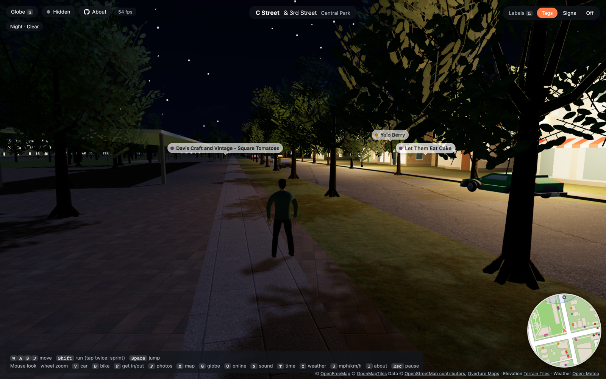

# Open World

A third-person browser game built from real map data. Walk, run, cycle or drive through
neighborhoods generated from [OpenStreetMap](https://www.openstreetmap.org), enriched with
Overture Maps places and buildings, and shaped by real terrain. Pick a place on the globe;
streets stream in as you explore, with traffic, pedestrians, live weather, police chases
and races along real roads.

The geography comes from open data; building details, scenery and game events are generated.
Downtown Davis, California is the default starting point and has extra mapped detail.

**[Play in your browser](https://open-world-sigma-two.vercel.app)** ·
[Run locally](#quick-start) · [Controls](#controls) · [Graphics](#graphics-and-performance)


| Go anywhere from the globe | Paris, Le Marais | Davis after dark |
| --- | --- | --- |
|  |  |  |

Where it's going: more realistic places as people contribute real photos and video, and more
detail everywhere. See [docs/ROADMAP.md](docs/ROADMAP.md).

## Features

### Explore real places

- **Go anywhere:** search the globe, zoom in and select **Walk here**. Streets stream around
  you as you move. You can also start at your location or share a latitude/longitude link.
- **Terrain, streets and buildings:** hills, bridge decks, sidewalks, crosswalks, bike paths,
  parks and parking lots follow the mapped world. Buildings use real footprints and available
  heights, with generated facades, roofs, balconies and storefronts. USGS aerial imagery
  supplies roof colors in the US when available. Distant land and sea extend about 20 km.
- **Places and photos:** multilingual tags or physical signs, street names, nearby place
  information and credited Wikimedia Commons photos. Overture adds places and building
  footprints; downtown Davis also has richer pre-built OSM detail.
- **Navigation:** open the map with `M`, center it on a destination and select **Drive here**
  for OSRM directions, lane guidance, distance, ETA and automatic rerouting. The route appears
  on the map and minimap. Roadside guide signs and route shields use available Overture data.
- **Nearby players:** see other online players' names, avatars and vehicles. `O` controls
  visibility; starting at your own location leaves you hidden by default.

### Drive and play

- **Six cars and a bicycle:** summon your own, enter a parked car or take one from traffic.
  Cars have different masses, suspension and front, rear or all-wheel drive. Bikes lean into
  turns, with the rider's hands on the grips and feet following the pedals. The speedometer
  shows the road's speed limit, with mph or km/h chosen for the region or set manually.
- **Tire and suspension physics:** four wheel contacts share grip between acceleration,
  braking and cornering. Weight transfer produces body roll, braking dive and acceleration
  squat; suspension handles crests and landings. Five automatic gears, engine braking, drag,
  slope gravity and weather affect handling. Cars can understeer, oversteer and spin, and
  off-centre collisions turn them. The car simulation runs at 120 Hz independently of rendering.
- **Traffic and police:** nearby traffic anticipates obstacles, keeps gaps, obeys traffic
  lights and sometimes honks when blocked. Police react to observed driving offences;
  prolonged pursuits bring tougher units, roadblocks, spike strips and damaged tires.
  Stay out of sight to lose heat, or risk being boxed in and losing your car.
- **Races and speed challenges:** slow down near a race beacon while not wanted to start a
  sprint or two-lap circuit against three AI rivals. Generated speed cameras record passing
  speed; speed zones measure the average between gates. Personal bests stay in your browser.
- **Speed Points and nitrous:** earn points and combo bonuses for near misses, drifts,
  oncoming driving, top speed, police takedowns and escapes. Hold `Shift` for limited nitrous;
  driving awards help refill it. Mapped gas stations repair tires, refill nitrous and respray
  the car, reducing heat when police have lost sight of you.
- **Driving feedback:** tire slip produces skid marks, smoke and squeal; wet roads throw spray,
  natural ground raises dust, and impacts spark. Engine sound follows RPM and load. The camera
  looks ahead with speed, `C` gives a rear view, and `H` sounds the horn. Headlight and police
  light halos respect viewing direction and obstructions.

### People, scenery and atmosphere

- **Four textured avatars:** choose Sam, Maya, Harper or Jordan and a player name. Walking,
  jogging and sprinting blend with speed, with opposite arm/leg swing, narrower strides,
  forward-bending knees and heel-to-toe motion. Footsteps follow ground contact.
- **Pedestrian variety:** strollers, commuters, walkers and joggers vary in clothing, build,
  pace and pauses. Up to eight nearby pedestrians (four on mobile) follow sidewalks and paths,
  turn corners, yield, pass one another and react to approaching cars.
- **Contact with the ground:** feet adapt individually to slopes and curbs; tires use their
  size, steering and suspension travel to meet the rendered road. Traffic and parked cars
  follow road pitch and cross-slope, including hills and supported bridge decks.
- **Trees and water:** six broadleaf, columnar and conifer forms with textured bark, branching
  trunks, roots and leaves or needles. Wind moves foliage and its shadows, and drives ripples
  and reflections on water. Streets also have lamps, benches, bike racks and hydrants.
- **Time and weather:** the sun follows the location and real time, with sunsets, stars,
  illuminated windows and night lighting. Open-Meteo conditions refresh every 15 minutes,
  driving clouds, rain, snow, fog and storms. `T` and `Y` select time and weather presets.
- **Adaptive graphics:** automatic resolution targets 45 fps while retaining model, texture
  and shadow detail. Shared resources, compact meshes, distance detail and less work on
  off-screen objects reduce rendering cost and memory use. See [graphics settings](#graphics-and-performance).

## Quick start

Requirements: Python 3.9+, a browser with WebGL 2, and an internet connection for map data
and browser libraries. No Node.js, npm install or build step is needed to play.

```bash
python3 serve.py
```

Open <http://localhost:8080>. The globe flies to Davis; press **Walk here** (or search for
somewhere else first).

The server only serves files; the browser fetches world data directly from its sources.
The server listens on all interfaces, so other devices on your network or
[Tailscale](https://tailscale.com) tailnet can play at
`http://<this-machine's-ip>:8080`. Set `PORT=9000` to use a different port.

Links: `http://localhost:8080/#48.85745,2.36154` starts walking at that latitude/longitude;
the address bar keeps your current position so you can share it.

## Controls

| Action | Keys |
| --- | --- |
| Move | `W` `A` `S` `D` or arrow keys |
| Run / jump | `Shift` / `Space` |
| Sprint | Tap `Shift` twice and hold |
| Look | Mouse (or `Q` / `E`); if the mouse can't be captured, click and drag |
| Zoom camera | Mouse wheel |
| Labels: tags → signs → off | `L` |
| Photos of the place you're at | `P` |
| About, graphics, character, credits and settings | `I` (also on the pause screen and the globe) |
| Show or hide yourself to other players | `O` (or the Online button) |
| Your car / your bike (`V` again: another car model) | `V` / `B` |
| Get in or out (also any parked or passing car) | `F` |
| Accelerate / steer | `W` / `A` `D` (or arrow keys) |
| Car service brake, then reverse | `S` or down arrow |
| Car rear handbrake / bicycle brake | `Space` |
| Nitrous while driving a car | Hold `Shift` |
| Look behind / horn | Hold `C` / `H` |
| Sound on / off | `N` |
| Time of day: live / day / sunset / night | `T` |
| Weather: live / clear / rain / snow / fog | `Y` |
| Speed in mph / km/h | `U` |
| Map: choose Walk here or Drive here | `M` |
| Fly out to the globe | `G` |
| Respawn where you walked in | `R` |
| Pause when mouse capture is active | `Esc` |

On phones and tablets: the joystick sits in the bottom-left corner (push further to run; hold it
all the way for a moment to lock into a sprint, which keeps going after you let go until you
touch the joystick again), drag anywhere else to look and steer, pinch to zoom, and tap **Jump**.
While driving, the joystick accelerates and steers; pull it back to brake, then reverse.
Jump becomes **Handbrake** in cars or **Brake** on a bike, with **N₂O**, **Horn** and **Rear view**
buttons where applicable. **About → Joystick: Right** swaps the joystick and Jump.

Desktop mouse look captures and hides the cursor. If capture is unavailable, the game uses
click-and-drag. The directions panel's **×** button ends navigation; `Esc` pauses rather than
canceling the route. Cursor recovery after `Esc` has been reported unreliable in Safari and
remains an open issue.

## Graphics and performance

Open **About (`I`) → Graphics**:

- **Auto · smoother** adjusts the 3D rendering resolution in small steps, targeting 45 fps
  to leave room above 40. It restores resolution when performance allows. High-density
  displays may look softer during demanding scenes; interface text remains at native resolution.
- **Full resolution** keeps the game's maximum render resolution, capped at 2× pixel density
  on desktop and 1.5× on mobile. It can run more slowly than Auto.

Both modes use the same model, texture and shadow settings. Trees use simpler distant meshes,
off-screen pedestrians do less animation work, and shared textures, compact geometry and
bounded map/terrain caches limit memory use. The FPS counter measures actual frame intervals.
The target is not a frame-rate guarantee: device, screen size, city density and chunk loading
all affect performance.

## How it works

```
Globe (MapLibre + OpenFreeMap) ──"Walk here"──▶ street world at that point
                                                 │
 OpenFreeMap vector tiles (whole planet) ────────┤  browser downloads ~2 km tiles,
 data/detail/*.json (pre-built richer areas) ────┘  cuts them into ~500 m chunks and
                                                    builds streets, buildings and props
                                                    around the player as they move
 Overture places, buildings and road signs ──────▶ enrich the streamed map data
 Terrain Tiles (elevation PNGs) ──────────────────▶ everything is draped on the ground
```

The client uses plain JavaScript ES modules, three.js 0.160.1 and MapLibre GL JS 5.24.0.
Rendering, world generation, movement and physics run in the browser; `serve.py` is a plain
file server. External services provide map data, search, routing, photos and weather.
The project's only backend is the optional multiplayer relay in `relay/`, which forwards
nearby players' state; the game also works with multiplayer disabled. See
[docs/ARCHITECTURE.md](docs/ARCHITECTURE.md) for details and [docs/DATA.md](docs/DATA.md) for
the data formats.

World detail depends on source coverage. Missing heights and styles are inferred, generated
race starts and speed challenges are game events, and traffic currently assumes right-hand
driving even in regions that drive on the left.

## Project layout

```
index.html              Page, HUD and globe UI, styles, script/import map
js/main.js              Boot, screens (globe/loading/street), input, HUD, game loop, spawning
js/rendering.js         Adaptive graphics resolution and lighting work reduction
js/geometry.js          Compact static scenery through exact shared-vertex indexing
js/globe.js             MapLibre globe, place search and reverse geocoding (Nominatim)
js/materials.js         Shared textured materials (CC0 textures in assets/textures)
js/aerial.js            Roof colors sampled from USGS aerial imagery (US only)
js/geo.js               Web Mercator tiles and the local metric frame around the walk-in point
js/terrain.js           Elevation from Terrain Tiles (Terrarium PNGs), sampled per point
js/farview.js           Distant land and sea out to ~20 km, beyond the streamed streets
js/tiledata.js          Load a tile (vector or detail) and convert it to the common format
js/overture.js          Enrich map tiles with places, buildings and road sign data
js/mvt.js               Minimal Mapbox Vector Tile decoder
js/bridges.js           Bridge deck heights and approach ramps
js/chunks.js            Streaming: tile prep, clipping into chunks, full/lite builds, unloading
js/clip.js              Polygon and polyline clipping to chunk rectangles
js/world.js             Chunk indexes and world queries: collision, curbs, streets, locations
js/surface.js           Ground contact sampled from rendered terrain, road and sidewalk triangles
js/streets.js           Ground, areas, roads, markings, crosswalks, sidewalks, furniture spots
js/buildings.js         Building styles, heights, facades, roofs
js/props.js             Trees, lamps, benches, bike racks, hydrants, parked cars (instanced)
js/trees.js             Shared textured tree geometry, wind and distance detail
js/labels.js            Place labels: floating tags, 3D signs, street signs, info-card lookup
js/photos.js            Photos of places from Wikimedia Commons (matched through Wikidata)
js/minimap.js           Rotating minimap from per-chunk canvases
js/navigate.js          OSRM directions, lane guidance, route progress and rerouting
js/roadsigns.js         Roadside guide signs and route shields
js/character.js         Shared avatars, gait blending, arm swing, foot placement and rider poses
js/profile.js           The player's name and character, kept on the device
js/vehicles.js          Car/bike models, terrain contacts, collision impulses, the rider
js/carphysics.js        Tire forces, suspension, drivetrain, weight transfer and surface grip
js/traffic.js           Traffic cars following the streets, and traffic lights
js/police.js            Police: crimes, wanted level, chases, roadblocks, busted/escaped, siren
js/arcade.js            Speed Points, nitrous refill, gas station service and crash camera
js/speedcams.js         Generated speed cameras/zones and saved personal bests
js/races.js             Sprint and circuit routes, checkpoints, AI rivals and race results
js/atmosphere.js        Sun position, sky, clouds, live weather (Open-Meteo), rain/snow, night lights
js/drivingfx.js         Tire tracks, smoke, spray, dust, impact sparks and batched light halos
js/soundscape.js        Synthesized engine, tire, impact, horn, footstep and rain audio
js/pedestrians.js       Bounded local walkers on verified sidewalks and footpaths
js/people.js            Deterministic pedestrian appearance and behavior factory
js/limits.js            Speed limits by road class (mph in the US and UK, km/h elsewhere)
js/multiplayer.js       Other players: connection to the relay, their characters and name tags
js/player.js            Movement, collision response, third-person camera
js/touch.js             Touch controls: fixed joystick with sprint lock, look, pinch zoom, Jump
js/util.js              Geometry helpers, spatial hash, mesh builder, time slicing
data/detail/            Pre-built detailed tiles (downtown Davis)
assets/textures/        CC0 material textures (see CREDITS.md there)
assets/characters/      CC0 textured character models and lighter population meshes
assets/nature/          CC0 bark and foliage textures (see CREDITS.md there)
assets/vehicles/        CC0 car models (see CREDITS.md there)
assets/effects/         CC0 smoke texture (see CREDITS.md there)
assets/icons/           App icons (tab, home screen); favicon.ico and site.webmanifest sit at the root
serve.py                Static file server (Python standard library only)
relay/                  Multiplayer relay (Cloudflare Worker + Durable Objects), deployed separately
tools/build_detail.py   Build detailed tiles from OpenStreetMap (Overpass API)
tools/fetch_textures.py Download and prepare the material textures
tools/fetch_nature.py   Prepare bark and foliage textures with credits
tools/prepare_people.py Prepare textured avatars and lighter population models
tools/pack_character.py Pack a character .gltf into a compact .glb with the animations the game uses
tools/screenshot.py     Headless screenshots for checking visual changes
tools/check_*           Physics, ground contact, gait, geometry and rendering checks
docs/                   Architecture, data formats, roadmap, images
```

## Deploying

It's a static site: any static host works, with no build step. On [Vercel](https://vercel.com),
import the repository with **Framework Preset: Other** and **Root Directory: the repository
root** (Vercel may suggest Python and `tools/` because of the scripts there; don't accept that).
`vercel.json` sets cache headers for textures and map data. Every push to `main` redeploys.
Live: <https://open-world-sigma-two.vercel.app>.

The multiplayer relay runs on Cloudflare (Workers free plan): `cd relay && npx wrangler deploy`.
To test multiplayer locally, run `npx wrangler dev` in `relay/` and open the game with
`?relay=ws://localhost:8787`.

## Adding a detailed area

Detailed tiles come from `tools/build_detail.py`. Add the tile (zoom 14 x/y) to
`DETAIL_TILES` in that file, run `python3 tools/build_detail.py`, and commit the generated
`data/detail/` files. Everywhere else uses the vector tiles automatically.

## Contributing

- Read [AGENTS.md](AGENTS.md); it is the short guide for anyone (person or tool) changing the code.
- Keep the runtime a static site with no build step. Changes should work with both detailed
  Davis data and vector tiles elsewhere.
- For visual changes, inspect Davis and a vector-tile city such as Paris. For streaming changes,
  walk or drive across several chunks and watch for long frames and missing geometry.

With the local server running, `/?test` enters Davis directly; `/?test&at=LAT,LON` enters
another location. Test mode skips mouse capture and stays offline unless a relay is specified.

Optional browser-check setup and screenshots:

```bash
python3 -m pip install -r tools/requirements.txt
python3 -m playwright install chromium
python3 tools/screenshot.py davis paris
```

Inspect the images in `screenshots/` and the reported page/console errors. Use `--software`
where hardware WebGL is unavailable; software rendering is unsuitable for FPS measurements.
Standalone physics and ground checks use Node.js without npm dependencies:

```bash
node tools/check_carphysics.mjs
node tools/check_ground.mjs
```

Browser checks for gait, geometry and rendering performance are documented in
[docs/ARCHITECTURE.md](docs/ARCHITECTURE.md). Run GPU benchmarks one at a time.

## Credits and license

- Map data © [OpenStreetMap contributors](https://www.openstreetmap.org/copyright) (ODbL).
  Vector tiles by [OpenFreeMap](https://openfreemap.org) using the
  [OpenMapTiles](https://openmaptiles.org) schema. Search by [Nominatim](https://nominatim.org).
  The in-game credit lines must stay visible.
- Additional places, buildings and road sign data from [Overture Maps](https://overturemaps.org),
  with [source-specific attribution](https://docs.overturemaps.org/attribution/).
  Routing by [OSRM](https://project-osrm.org), using [FOSSGIS](https://routing.openstreetmap.de/about.html)
  and the OSRM demo server as a fallback. See [data sources](docs/DATA.md).
- Material textures from [Poly Haven](https://polyhaven.com) and [ambientCG](https://ambientcg.com),
  CC0 ([list](assets/textures/CREDITS.md)); tree textures also by Poly Haven
  ([credits](assets/nature/CREDITS.md)). Textured characters by
  [Innerscene](https://www.innerscene.com/tools/library), using MakeHuman CC0 assets;
  original low-poly characters by [Quaternius](https://quaternius.com)
  ([character credits](assets/characters/CREDITS.md)). Cars by [Kenney](https://kenney.nl), CC0
  ([list](assets/vehicles/CREDITS.md)), and smoke particles by Kenney, CC0
  ([credits](assets/effects/CREDITS.md)). Roof colors from USGS/USDA orthoimagery
  ([The National Map](https://www.usgs.gov/programs/national-geospatial-program/national-map)), public domain.
- Elevation from [Terrain Tiles](https://registry.opendata.aws/terrain-tiles/) on AWS (Mapzen;
  USGS 3DEP, SRTM, GMTED2010, ETOPO1, EU-DEM and national datasets); the full required
  attribution is in [docs/DATA.md](docs/DATA.md#elevation).
- Place photos from [Wikimedia Commons](https://commons.wikimedia.org), each under its own
  license with its author credited in the game; places are matched through
  [Wikidata](https://www.wikidata.org) (CC0).
- Weather data by [Open-Meteo.com](https://open-meteo.com) (CC BY 4.0).
- Rendering by [three.js](https://threejs.org) (MIT) and [MapLibre GL JS](https://maplibre.org)
  (BSD), loaded from unpkg.
- Code is released under the [MIT License](LICENSE).
