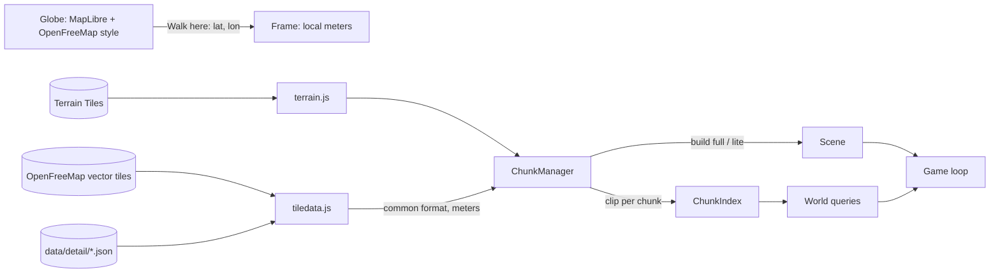

# Architecture

## Overview

Everything runs in the browser. `serve.py` serves static files; it has no data logic.

- **Globe** (`globe.js`): MapLibre GL 5 in globe projection with OpenFreeMap's free "liberty"
  style, the RTL text plugin for Arabic-script labels, Nominatim search and reverse geocoding.
- **Street world** (`main.js` → `chunks.js`): created by `enterStreet(lat, lon, bearing)`, which
  makes a new `Frame` at that point, streams chunks around the player and spawns them on the
  nearest street.
- **Start:** a `#lat,lon` link or `?at=` walks straight in. Otherwise the globe opens and the
  browser asks for the device's location; if it's shared (and the player hasn't started
  exploring the globe meanwhile) the street world opens there, else the globe flies to Davis.

## Coordinates

`Frame` (`geo.js`) puts the origin at the walk-in point: `+x` east, `+z` south, `+y` up, in
meters. Positions come from Web Mercator scaled by `cos(origin latitude)`, accurate to about 1%
within a few kilometers. Walking in somewhere else creates a new frame and a new world.

Two tile zooms matter:

| Zoom | Size (equator / Davis / Paris) | Used for |
| --- | --- | --- |
| 14 (`DATA_ZOOM`) | 2.4 km / 1.9 km / 1.6 km | One download (vector tile or detail file) |
| 16 (`CHUNK_ZOOM`) | 610 m / 480 m / 400 m | One chunk: clipped, indexed, built, dropped as a unit |

## Data sources (`tiledata.js`)

For each z14 tile:

1. If `data/detail/index.json` lists it, load `data/detail/14/x/y.json`: rich OpenStreetMap data
   built by `tools/build_detail.py` (building types, mapped sidewalks and crossings, trees,
   benches, opening hours).
2. Otherwise fetch the OpenFreeMap vector tile (URL template from its TileJSON), decode it with
   `mvt.js` and convert the OpenMapTiles layers with `adaptVector()`.

Both produce the same common format in tile units ([DATA.md](DATA.md)); `toLocal()` converts it
to meters in the current frame. The browser's HTTP cache keeps tiles for revisits.

## Terrain (`terrain.js`)

Elevation comes from [Terrain Tiles](https://registry.opendata.aws/terrain-tiles/) on AWS in the
Terrarium encoding (PNG, `height = R·256 + G + B/256 − 32768` meters) at zoom 15: about 4.8 m per
pixel at the equator. Its sources are USGS 3DEP in the US (≈3–10 m) and SRTM/GMTED elsewhere
(≈30–90 m). Each z14 data tile loads its four z15 elevation tiles alongside the map data; the
walk-in tile is loaded first so the frame's base height is known before anything is built.

`Terrain.at(x, z)` interpolates bilinearly and returns meters **relative to the walk-in point**,
so `y = 0` is the ground where you entered. `water(x, z)` is the same but never below sea
level (elevation data under the sea is the sea floor). Missing tiles count as unknown and the
neighbors' heights are used; where nothing is known the world is flat.

How builders use it:

- **Ground layers** (ground, areas, roads, sidewalks, markings) are written through a draping
  `GeoBuilder`: every triangle is split until no edge is longer than `maxEdge`, and each vertex
  gets the terrain height added. Edges are split by their own length only, so two triangles
  sharing an edge split it the same way and there are no cracks. `maxEdge` comes from the
  chunk's measured relief (40 m when flat, 12 m when gentle, 5 m when hilly; doubled in lite
  chunks), so flat cities don't pay for hills.
- Layers cut into different triangles can cross each other by a few centimeters on slopes.
  Instead of raising them, each ground material is drawn slightly toward the camera along the
  view ray (`layered()` in `materials.js`), in order ground < grass/water < gravel/lots/pavers <
  roads < sidewalks < paint. This also handles intersections between independently draped layers.
  People and cars use the same depth frame as the highest street layer, so roads cannot
  draw over correctly grounded shoes or tires. This does not change geometry or shadows.
- **Buildings** stand on one base height: the highest ground under the footprint, or the middle
  of the range on steep lots (more than 6 m of fall), so they never float. Walls on the downhill
  side get a concrete foundation down to the ground. `b.base` and `b.top` are absolute heights.
- **Props** sit on `groundAt`; parked and traffic cars fit all four tire contacts, including
  the road's cross-slope. Each built chunk owns a spatial index of its rendered street
  triangles (`surface.js`). Contact queries use those exact faces and normals, with
  terrain/deck fallbacks while chunks load; bridge queries retain the caller's height.
- **Labels** and street signs add the ground height at their position.

Bridges and elevated highways still follow the ground (see the roadmap); tunnels are not drawn.

Beyond the streamed chunks, `farview.js` draws the landscape out to about 20 km: a ring mesh
around the player (dense near, coarse far) sampled from zoom-12 terrain tiles, colored by height
and slope (sand, green, rock, snow), plus a sea disc at sea level where the land dips below it.
It sinks a little near the player and is drawn slightly behind in depth, so the detailed ground
always wins. When the camera is well above the lowest ground around (a hill, a tower), the fog
is pushed out to as far as 16 km, so the view opens up; the camera's far plane is 30 km.

## Roof colors (`aerial.js`)

For tiles inside the US, the USGS/USDA orthoimagery export for the tile's extent (1024 px,
about 1.5–2.4 m per pixel) is fetched alongside the map data. Each building samples a grid of
pixels inside its footprint, drops shadows and green tree canopy, and keeps the median as its
roof color. Reddish roofs become clay tile; the roof texture is tinted so its average matches
the measured color.

## Tile preparation (`chunks.js: prepareTile`)

Once per z14 tile, in meters:

- **T-junction repair:** a side street's end point that lies on another street's segment is
  inserted into that segment, so intersections can be found by matching coordinates.
- **Road-width fitting:** perpendicular rays from points along each street measure the
  wall-to-wall width; if buildings are closer than the default road width allows, the
  carriageway is narrowed to leave about 2 m of sidewalk on each side.
- **Footway classification** (vector tiles only): footways running alongside a street become
  sidewalks; stretches crossing the asphalt at an angle become crossings.

## Streaming (`ChunkManager`)

Each frame `update(x, z)` re-plans and a single worker loop runs one job at a time, nearest first:

1. **Index** every wanted chunk: clip the tile's data to the chunk rectangle (`clip.js`), build
   a `ChunkIndex` (classified roads with widths, junctions, buildings with zones, areas, places,
   spatial hashes) and register it with `World` and the minimap.
2. **Build full** chunks within `FULL_R` (230 m) and **lite** chunks within `LITE_R` (650 m).
3. **Downgrade** full chunks beyond `DOWN_R` (420 m) to lite; **drop** chunks beyond `DROP_R`
   (900 m), disposing their meshes, indexes, labels and minimap canvases.

Indexing everything first means builds can see neighboring chunks (for example, a building's
nearest street may be across a chunk border). Builds are async and call `budget.tick()` to
yield every ~5 ms, so the game keeps rendering while new areas are built. Rebuilds swap the new
group in only when complete, so there are no holes.

Clipping keeps chunks independent: buildings cut by a chunk edge are drawn in two pieces whose
cut edges (`seam`) get no wall, so they read as one building.

## World model (`world.js`)

`World` holds the loaded `ChunkIndex`es and finds the ones relevant to a query from the chunk
grid. Main queries:

| Method | Answers |
| --- | --- |
| `resolveCircle(x, z, r)` | Pushes a circle out of building/car polygons and round colliders. Used for movement. |
| `elevation(x, z)` | Terrain height relative to the walk-in point (`0` without terrain). |
| `groundAt(x, z, y?, normal?)` | Height of the rendered street/sidewalk triangles, with optional support normal. Caller height selects reachable bridge decks; terrain is the fallback before a chunk is built. |
| `onSidewalk(x, z)` | Whether a point is on a raised sidewalk (use this, not `groundAt > 0`, which is meaningless on hills). |
| `buildingAt`, `heightAt` | Building under a point and its height. Camera and label occlusion. |
| `nearestRoad`, `onRoad`, `nearPath`, `nearSidewalk` | Street geometry lookups used by builders and HUD. |
| `locate(x, z)` | Street, cross street, and area (named park, OSM neighborhood, or reverse-geocoded name). |

## Builders

- **Streets** (`streets.js`): ground quad, area fills, road ribbons with end caps; in full detail
  also double yellow center lines on two-way major roads, stop lines before intersections,
  crosswalk stripes over asphalt, footpaths, raised sidewalks (mapped ones first; generated
  along streets where none is mapped within 6.5 m), and spots for street trees, tree wells,
  lamps and parked cars. Lite: ground, areas and asphalt only.
- **Buildings** (`buildings.js`): style from OSM type when known, otherwise from places inside,
  landuse zone, footprint size and floor count; height from data or a per-style guess; walls,
  hip roofs on rectangular houses and churches, flat roofs elsewhere; facades with windows,
  doors, storefronts, awnings and cornices; towers get one glass band per floor. Real
  `building:colour` overrides the palette. Lite: walls and roofs only.
- **Props** (`props.js`): instanced trees (mapped, street trees, park scatter), lamps, benches,
  bike racks, hydrants, bins and parked cars with shared geometry and colliders.
- **Labels** (`labels.js`): per chunk; wall signs on street-facing walls, lawn signs for houses,
  post signs for parks and free-standing places, green street-name blades at intersections;
  floating HTML tags with occlusion and declutter; modes tags/signs/off.

## Place photos (`photos.js`)

When the info card shows a named place, `placePhotos` looks for its Wikidata item: a full-text
search for the name limited to items with an image (P18) within 300 m (`nearcoord:`), then a
check that one of the item's labels or aliases, in any language, equals the name after
normalizing case and punctuation. Its main image and up to seven more from its Commons category
(P373) come from the Commons `imageinfo` API with author and license. Places without a match
(most shops and cafés) show no photo. Results are cached per place for the session. The card
shows the first photo and its credit; `P` (or tapping the card) opens a full-screen viewer.

## Characters (`character.js`, `profile.js`)

The profile offers four textured CC0 Innerscene/MakeHuman people: Sam, Maya, Harper and Jordan.
The legacy `man`/`woman` IDs map to Sam/Maya. The name and choice remain in localStorage.
`tools/prepare_people.py` prepares the downloaded locomotion collections offline: geometric
simplification preserving UV seams and skin weights, texture resizing, removal of held props
and microscopic geometry, and retaining Idle/Walk/Jog/Run. The browser has no new dependencies.
Full meshes have about 23–30k triangles; background meshes have about 11–14k. Texture files are
local and shared between variants; a procedural figure is available while loading or on failure.

`Character` clones the skeleton and shares geometry/materials. Population clothing tints clone
only the affected materials. `dispose()` releases those materials and each clone's bone textures.
Locomotion blends by actual speed, with walk/jog/run clips synchronized to one foot-contact phase.
Two-bone leg positioning keeps feet under the hips, holds ground-contact speed against movement,
and adds heel-to-toe roll and bent-knee recovery. Faster running shortens ground contact and adds
flight time while keeping cadence below four steps per second. Shoulder swing follows the
opposite leg's movement through the procedural stride, preserving the clips' elbow and wrist
poses; it blends out for idle and airborne poses. The solver works before model
scaling so pedestrian build variations keep connected joints. Footstep audio consumes the same
contact counter; walking speed is 1.6 m/s. Idle phases are offset per person, with restrained head
glances. Procedural edits restore the last unmodified mixer pose
before each update; restoring bind rotations would break cached constant animation tracks.
Grounded people fit each shoe to the surface normal and measured shoe bounds, with a pelvis
adjustment and two-bone reach for slopes and curbs. Contact refreshes every frame even when
pedestrian animation is throttled. Airborne and seated poses bypass foot grounding.
Bicycle poses use analytic two-bone reach to the grips and crank, including separately rigged feet.
The local and remote rider follow the actual bicycle pedal angle.
With the local server running, `python3 tools/check_gait.py` checks hand/foot coordination
and connected arm joints across all avatar and pedestrian variants (add `--channel chrome`
to use an installed Chrome). It measures the posed skeleton through walking and running speeds.

The relay accepts the four look IDs. Updating an existing hosted relay requires its normal,
separate deployment; an older relay falls back to Sam for the two new IDs.

## Multiplayer (`multiplayer.js`, `relay/`)

Players connect with a WebSocket to the relay, a Cloudflare Worker whose `Room` Durable Object
(one per zoom-6 map tile, about 600 km) forwards each player's messages to the others in the
room within 2 km. Positions travel as latitude/longitude, so they line up even though every
player's world has its own frame. A player sends `{ name, look }` once and then their state
(lat, lon, yaw, speed, height above ground) up to 5 times a second while moving and every 2 s
when still; newcomers get the states of everyone nearby right away. Others are drawn as
`Character`s gliding toward their latest position, animated by the speed they report, with a
name tag above the head, and appear as blue dots on the minimap; anyone silent for 6 s is
removed. The relay keeps nothing but the live connections, limits each player to 12 messages a
second, and cleans names. Hidden players don't connect at all.

## Cars and bikes (`vehicles.js`)

`V` / `B` bring the player's car (to the right-hand lane of the nearest street) or bike (beside
them); `F` gets into the nearest one, or into a parked car, which is taken off its chunk's
instanced mesh and replaced by a drivable `Vehicle` of the same model. Cars use `CarPhysics`
(`carphysics.js`), an original force-based model in SI units, stepped at a fixed 120 Hz. Its
four wheel contacts have combined longitudinal/lateral friction limits, slip-dependent adhesion,
load sensitivity and Ackermann front steering. The tires generate yaw torque about the centre
of mass; the heading no longer directly sets the direction of travel. Suspension springs and
dampers determine individual wheel loads and body heave/pitch/roll, including load transfer,
loss of contact over crests, and landing compression. Wheelbase, track and the collision footprint
come from the car model. Bikes retain their kinematic steering and terrain following.
Car meshes are aligned with the solver's centre of mass. After the physical step, each tire
fits its actual radius and tread width to the road along the tilted suspension axis; exhausted
compression constrains the body above the surface, while airborne wheels retain limited droop.
The camera chases behind the vehicle, and
while driving, chunks are requested ahead in the direction of travel. A car hides its driver; a
bike carries the character in a pedaling pose. Other players' vehicles come through the relay
as a `v` field and are drawn from the same models.

`CAR_HANDLING` supplies independently tuned mass, centre-of-mass height, static front weight,
front/rear drive split, grip, suspension and aerodynamic area per car. Five gear ratios, a torque
curve, shift interruptions, an RPM limiter, rolling resistance and engine braking govern speed.
Nitrous adds engine torque; it does not change the gearing. Reverse engages after braking to a
near stop. Service braking has front bias and ABS (except the van); the rear handbrake bypasses
ABS and can cause a full spin. There is no sideways-speed clamp, artificial slide recovery, or
yaw assistance. Rain, snow, natural ground and flat tires change adhesion/resistance. Weather is
shared through `world.drivingWeather`, including police and race rivals; their path controllers
request curvature and reduce speed for available grip.

`World.resolveCircle` optionally reports normals/contact points. Cars use those for impulses
with mass and yaw inertia, including equal/opposite impulses between active vehicles. Each
movement substep travels at most 0.4 m; bridge edges retain their railing constraint. Each impact
increments `impactSerial`, with a short cooldown, so sound and particles consume the same event
independently. Landings trigger impact sound without metal sparks. `Vehicle.stop()` resets
momentum when parking, resetting a race grid or wrecking a police car.

This is a heightfield vehicle model, not a general 3D rigid-body engine: the collision hull has
no roof/side ground contacts, tilt is bounded to ±0.8 radians, and cars cannot fully roll over or
deform. Instanced ambient traffic still follows road paths and acts as a collision obstacle;
only active `Vehicle`s exchange dynamic impulses. Wheel spin is estimated from excess tractive
force rather than a separate wheel angular-inertia solver. Physics concepts were studied in
reVC's wheel/suspension/transmission code; its source and handling tables are not included.
`node tools/check_carphysics.mjs` checks mechanical behavior and display-rate independence.

The camera
looks a little ahead of a moving car; `C` (or Rear view on touch) looks behind. Camera occlusion
checks real building bounds and terrain, including locations below the world's elevation datum.

## Driving effects (`drivingfx.js`)

Driving effects (`drivingfx.js`) use four fixed-size batches: fading tire-track strips, smoke/spray
billboards, additive light halos and impact sparks. Individual loaded wheel contacts leave tracks
when their tire forces exceed grip on roads and bridge decks, using `groundAt(x, z, y)` and the
ground material depth bias. Airborne wheels emit no tire effects. Marks expire
after 28 simulation seconds; smoke drifts with the atmosphere's wind and is reduced in rain.
The same puff pool supplies brief tire spray on wet roads and dust off-road. Sparks have a
separate short-lived pool with gravity; none of the particles create collision objects.
Halos follow car light anchors and street lamps, use depth testing and a bounded number of cached
visibility checks, and add no scene lights. Mobile uses smaller pools. Changing places clears all
effects and their visibility caches; the shared rendering buffers are reused.

## Sound (`soundscape.js`)

Original Web Audio synthesis supplies the player's engine (using the physics RPM and shift load), tire
squeal and road noise, footsteps, impacts, horns and rain. It shares the siren's AudioContext,
unlocked/resumed only after a user gesture, and the existing persisted sound toggle (`N`).
Continuous voices are reused; at most eight transient sounds play at once. Traffic horns are
distance-attenuated and panned relative to the camera, with a global cooldown. Pause, hidden
tabs and the globe mute the soundscape. World changes stop pending transients.

## Pedestrians (`pedestrians.js`)

A reusable pool holds at most eight CC0 `Character`s (four on mobile). `people.js` is a
small deterministic factory of appearance and behavior descriptors: stroller, commuter, walker
and jogger templates choose clothes, proportions, phase, pace and pause duration. Each four slots
include all four base characters. The pool uses the lighter meshes without extra shadow draws;
animation updates run at 30 Hz nearby and 15 Hz at distance/on mobile, while movement is smooth.

Initial paths come from full chunks' raised sidewalks and mapped footpaths. A sampled forward
fan extends them around corners, checking buildings, roads, props and terrain steps. People ease
into movement, pause occasionally, yield to the player, try to pass each other where there is
room, and hurry away from approaching vehicles along safe paths. They do not cross roads or
plan journeys to destinations. Leaving the area or changing worlds hides/reuses the pool.

## Trees (`trees.js`, `props.js`)

Existing mapped/derived tree placement and trunk colliders are unchanged. Shared, instanced
geometry provides two shapes each of round broadleaf, columnar and conifer trees, with tapered
branches, forks and root flares. Poly Haven CC0 bark and isolated photographic leaves/needles
are stored in `assets/nature/`; `tools/fetch_nature.py` prepares them offline. The broadleaf atlas
is explicitly masked to exclude the source mesh's UV padding, then composed into branching twigs.

Cutout, depth-writing foliage has canopy normals and vertex shading. Lit and depth materials
share the same wind deformation; time/wind follow atmosphere values. Bounds include wind sway.
Every half-second, instance matrices are split into detailed nearby trees (65 m desktop / 40 m
mobile, with 10 m hysteresis) and simpler distant trees. Only nearby trees cast shadows. All
batches belong to their chunk, and chunk disposal frees the instance buffers while retaining
shared materials and geometry. There is no per-tree animation loop or asset fetch during play.

## Traffic (`traffic.js`)

`World` keeps a map of every car-road vertex (`nodes`), filled as chunks are indexed, so traffic
can follow a road out of one chunk into the next and find the roads meeting at a junction. About
20 cars are kept 40–220 m around the player (spawned out of sight where possible, removed past
300 m). Each drives along its road in the right-hand lane at a speed set by the road class,
picks a way at junctions (mostly straight on), keeps a gap to cars, the player or a parked
vehicle ahead, slows at junctions without lights and stops at red ones. Lights come from
`ChunkIndex.signals`; one function, `signalState`, gives the light for an approach at a time, so
the lamps drawn in full chunks and the cars agree. Traffic cars are drawn as instanced car
models and are obstacles for the player; the player can get into one (`F`), which takes it out
of traffic. Traffic is local to each player.

The gap check looks up to 90 m ahead and ignores cars more than 2.5 m above or below the lane's local grade.
Stopping distance limits the target speed; travel is capped by the remaining gap. Drivers
occasionally honk after three seconds blocked, except when waiting at a red/yellow signal.

## Police (`police.js`)

Two of the traffic cars are police patrols. Each frame the game checks what the player is doing
in a car: speeding (20 km/h over a limit set by the road class), entering a junction on red,
crashing into a vehicle, or driving on a sidewalk or across a park. A crime counts only if a
police car can see it (within 75 m, no building in between). Then a chase starts: heat 1-5
grows with chase time (and each new crime); each level brings more units (2 to 6) and stronger
cars (police sedans, police SUVs, interceptors faster than any car you can drive), and from
heat 4 roadblocks of police cars across the street ahead. Units are ordinary `Vehicle`s driven
by a small controller: straight at the player when close and in sight, otherwise along an A*
route over the road graph to where the player was last seen; they back out when stuck and are
replaced if they stop getting closer. You're busted after 3.5 s slow with a unit within 9 m (the
car is impounded); you escape when no unit has seen you, and none is within 70 m, for the
cooldown (10 s + 3 s per heat level). The siren is a Web Audio oscillator whose volume follows
the nearest unit. All of it is local to the player.

## Time of day and weather (`atmosphere.js`)

The sun's elevation and azimuth come from the walk-in latitude/longitude and the current time
(a short solar-position formula); the light, sky and fog follow it, so it's day, sunset or
night as it really is there. Every 15 minutes the current weather is fetched from Open-Meteo
(free, no key) and its WMO weather code and cloud cover become amounts of cloud, rain, snow and
fog (and storms), eased in over a few seconds. The sky is one shader: a gradient by sun
elevation, a warm horizon band toward the sun at sunset, the sun disc and halo, procedural
clouds lit orange near sunset, and stars at night. Rain streaks and snowflakes are a few
thousand particles moved on the GPU in a box around the camera; wet weather makes paved
materials darker and glossier, snow whitens the ground. At night windows light up (a hash per
window cell in the glass shader), lamp heads glow, a fixed set of point lights moves to the
nearest street lamps, cars show head- and taillights and the player's car gets a headlight.
The reflection map is rebaked from the sky when it changes. Players can fix the time (day,
sunset, night) or weather (clear, rain, snow, fog) instead of live.

## Player, camera and HUD

- Movement relative to the camera (walk 2.2 m/s, run 5.6 m/s, sprint 9 m/s, jump), collision via
  `resolveCircle`, slopes and curbs via `groundAt`, no world bounds (chunks stream ahead of you).
- Third-person camera with shoulder offset; it pulls in before any wall between head and camera,
  and widens a little when sprinting.
- Input: keyboard and mouse (pointer lock, or click-and-drag), or touch (`touch.js`): a joystick
  fixed in a bottom corner, whose deflection blends walk into run and which locks into a sprint
  when held all the way for a moment (the sprint continues after the thumb lifts, steered by the
  camera, until the stick is touched again); drag-to-look and pinch-to-zoom anywhere else; a Jump
  button in the other corner. The About panel swaps the sides for left-handed players. Phones also render at a lower pixel ratio
  with a smaller shadow map.
- Spawn (`findSpawn`): nearest street to the chosen point → its sidewalk, else the street edge,
  else open ground; facing along the street in the direction closest to the map's bearing.
- HUD: location bar, label mode, info card for the nearest place (with a photo when Wikimedia
  has one), rotating minimap, fps, About panel (project link and all credits), credits; the URL hash tracks the current position.

## Materials

`materials.js` builds shared `MeshStandardMaterial`s once: textured ground (asphalt, light
asphalt for lots, concrete sidewalk, pavers, grass, gravel), walls (stucco, siding, two bricks,
concrete, corrugated metal) and roofs (shingles, clay tiles), plus untextured plain, paint, glass
and water. Builders write each surface into a `MultiBuilder`, one merged mesh per material per
chunk; vertex colors tint the textures (paint colors, roof colors). Texture coordinates come from
world position, so textures line up across faces and chunk borders.
Water adds two small animated normal ripples, driven by atmosphere time and wind, to move its
reflections without displacing shorelines or adding a render pass.

## Rendering and performance

One WebGL renderer with ACES tone mapping, an environment map baked from the sky gradient, standard depth, PCF soft shadows from a sun that follows the player
(±60 m), hemisphere light, gradient sky dome, fog from 120 to 620 m and a large ground plane under
everything, kept just below the lowest nearby terrain so it never shows above a valley. Standard
depth permits early rejection of hidden fragments; the camera near plane is 0.3 m to preserve
depth precision. Ground/contact view-space layering stays unchanged. The three.js loop stops
rendering while the globe is open.

`rendering.js` guards inactive/out-of-range point and spot light calculations in the pinned
Three r160 lighting chunk. Light slots stay fixed, so day/night transitions do not recompile
every material. Pixel comparisons against the original shader cover lights off/on, cutoff
distances and spot cones. Recheck this patch when upgrading Three.

`RenderQuality` defaults to automatic resolution, aiming for 45 fps to leave margin above 40.
It lowers the 3D buffer in small steps after sustained slow frames, raises it after sustained
headroom, ignores hidden-tab/long suspension samples, and never drops below one pixel per CSS
pixel. The HUD stays native-resolution and no models/textures are removed. About → Graphics
also offers the original maximum resolution (DPR capped at 2 desktop/1.5 mobile). This is a
target, not a guarantee on every device or in every city. The FPS counter uses real elapsed
time, separately from the 50 ms simulation step cap.

Scenery normals and linear colors use normalized 16-bit buffers (HDR colors retain floats).
`geometry.js` indexes byte-identical vertices with cooperative yields, preserving UV seams,
normals, colors and every surface position. Trees use 256 m instance batches and parked cars 96 m
for frustum culling. Tree instance buffers and bounds rebuild only when detail assignments
change. Characters have conservative whole-body bounds instead of disabling culling.
Off-screen pedestrians retain their behavior and movement but animate at 5 Hz without foot IK;
their pose/contact is refreshed immediately when they reenter the camera frustum.

Ground/roof texture instances are shared; full/distant character meshes share matching textures
and release loader parser caches. Sky rebakes dispose the entire old PMREM render target.
Data tiles retain live sources plus up to 12 cached tiles; raw street and far terrain tiles
are pruned outside their useful area, with margins for edge interpolation.

Checks (local server required, `--channel chrome` for installed Chrome):
`python3 tools/check_geometry.py --channel chrome` checks lossless indexing, quantization
precision, ground contacts, light pixels and resolution control.
`python3 tools/check_rendering.py davis --channel chrome --min-fps 40` measures actual frame
intervals at 1440×900 CSS pixels/DPR 2 and saves a screenshot; repeat for `paris` and `hill`,
and use `--night` to check night lighting. Geometry and texture estimates exclude driver,
render-target and browser overhead. Run benchmarks sequentially; concurrent GPU tests skew FPS.
