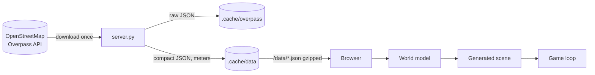

# Architecture

## Overview

The project aims to cover the whole world; today the server handles one fixed area at a time
(`WORLD` in `server.py`), currently downtown Davis. The plan for scaling up is in
[ROADMAP.md](ROADMAP.md).

Two halves:

- **`server.py`** knows about geography: it downloads OSM data for the configured area,
  converts latitude/longitude into local meters, keeps only the tags the game uses, caches both
  raw and processed results, and serves them. It never builds geometry.
- **The browser** knows about rendering and gameplay: it builds the whole scene procedurally
  from the data on every load (about 1–2 seconds), then runs the character, camera, labels and
  maps.

## Coordinate system

All game data is in meters relative to `WORLD.origin` (between B and C Streets near 3rd):
`+x` east, `+z` south, `+y` up. The conversion is an equirectangular projection
(`server.py: proj`), accurate to centimeters over a few kilometers.

Two boxes come from the server in `/data/meta.json`:

- `core`: the walkable, fully detailed area (A to D Street, 1st to 5th, plus a margin).
  The player is clamped to it.
- `context`: a larger box rendered in low detail (buildings and roads only) so the horizon
  isn't empty. Fog hides its edge.

## Server

| Endpoint | Returns |
| --- | --- |
| `/`, `/index.html`, `/js/*`, `/assets/*` | Game files (nothing else in the repo is served) |
| `/data/meta.json` | Area name, origin, meters-per-degree, `core` and `context` boxes, dataset list |
| `/data/<name>.json` | A processed dataset (gzipped). Blocks while it downloads; 503 if it failed |
| `/data/status` | Per-dataset status: `pending`, `downloading`, `retrying (n)`, `ready`, `error: …` |

On startup a background thread prepares each dataset in order: use the processed file from
`.cache/data/` if present, else fetch from Overpass (raw response cached in `.cache/overpass/`
by query hash), run the processor, and write the result. Downloads are sequential because
the public Overpass servers limit concurrent requests, and each dataset is retried up to four
times across mirror endpoints.

Processed files are keyed by the query text plus `PROCESS_VERSION`, so changing a query or
bumping the version regenerates them. Data formats are in [DATA.md](DATA.md).

## Client boot sequence (`js/main.js: load`)

1. Fetch `meta.json` and all datasets in parallel. `buildings` and `roads` are required;
   others fall back to empty.
2. **`new World(...)`** classifies roads (`car`, `service`, `sidewalk`, `crossing`, `path`,
   `plaza`), computes widths, orients polygons, and builds spatial hashes for road segments,
   path segments, junctions, buildings and colliders.
3. **Assign places to buildings:** each place point inside a footprint is attached to it.
4. **`planBuildings`** picks a style and floor layout per building and finds street-facing walls
   (using the nearest road to each wall).
5. **`buildBuildings`** generates one merged mesh for the core and a "lite" one for context.
6. **`buildStreets`** generates one merged mesh for ground, areas, roads, markings, crosswalks,
   paths and sidewalks, registers raised sidewalk segments, and returns *spots* where trees,
   lamps and parked cars can go.
7. **Props:** `buildTrees`, `buildFurniture`, `buildParkedCars` turn spots and mapped objects
   into instanced meshes and register colliders.
8. **`Labels.build`** decides where every place's sign goes and which corners get street signs.
9. **`MiniMap`** pre-renders the map once into a canvas.
10. Create the `Character` and `Player`, spawn at C Street & 3rd, start the loop.

## World model (`js/world.js`)

`World` holds the processed data plus indexes, and answers the questions everything else asks:

| Method | Answers |
| --- | --- |
| `resolveCircle(x, z, r)` | Pushes a circle out of building/car polygons and round colliders (trees, lamps, benches). Used for player movement. |
| `groundAt(x, z)` | `0.15` on a raised sidewalk, else `0`. Used for curb stepping. |
| `buildingAt(x, z)`, `heightAt(x, z)` | Building under a point and its wall height. Used by the camera and label occlusion. |
| `nearestRoad(x, z, maxD, filter)` | Closest road surface point. Used for street-facing walls, sign orientation, prop orientation. |
| `onRoad(x, z, pad, except, kinds)` | Whether a point is on asphalt. Used to clip sidewalks, paths and crosswalks. |
| `locate(x, z)` | Street name, cross street near an intersection, and named area (park) for the HUD. |

## Streets (`js/streets.js`)

- **Roads** are ribbons around the OSM centerline with a width per class (`world.js`), plus
  round caps at the ends so consecutive ways join cleanly. OSM `width`/`lanes` override defaults.
- **Center lines:** double yellow on two-way `tertiary` and larger roads, trimmed back from
  intersections. **Stop lines** sit 4.2 m before each approach to an intersection (right half
  of the road; full width for one-way roads).
- **Crosswalks** are ladder stripes drawn only where a mapped `footway=crossing` passes over car
  asphalt, unless it is tagged unmarked.
- **Sidewalks:** mapped `footway=sidewalk` ways are used as-is. Elsewhere, sidewalks are
  generated on both sides of every car road unless OSM says there is none or a mapped sidewalk
  is within 6.5 m. Roads with mostly shops or civic buildings nearby get a wide 3.4 m sidewalk
  at the curb; other roads get a 1.7 m sidewalk behind a 1.3 m planting strip. All sidewalks are
  clipped where they would cross another street, are raised 0.15 m, and have curb faces.
- **Spots:** street trees every 10–14 m in planting strips, tree wells every 9 m on wide
  sidewalks, lamps every 22–30 m, and parked cars in 6.3 m slots (42% filled) on residential
  streets, avoiding intersections, crosswalks and driveways.
- **Flat layer order** (lowest first): ground, farmland, grass/wood, water, pitches/playgrounds,
  parking, plazas, service roads, roads, paths, markings, crosswalks; sidewalks on top at
  0.15 m. The gaps are millimeters and rely on the logarithmic depth buffer.

## Buildings (`js/buildings.js`)

- **Style** (`styleOf`): `house`, `shopfront`, `civic`, `apartments`, `church`, `shed`, `canopy`,
  from the OSM `building` value, whether shops/restaurants are inside, and footprint area.
- **Height** (`layout`): OSM `height` if tagged, else floors from `building:levels` or a
  deterministic guess per style (e.g. houses 70% one story; shops 1–3 stories with a 4.6 m
  ground floor).
- **Geometry:** walls for outer rings and courtyards; hip roofs with eaves on houses and churches
  whose footprint is close to a rectangle, flat roofs otherwise; plinth strips; cornices on flat
  roofs; and facade details by style: windows with frames and sills, doors on the street-facing
  wall, storefront glass and striped awnings on shop walls that face a street.
- Randomness (colors, floors, awnings) is seeded by the OSM id, so the world looks the same on
  every load.

## Labels (`js/labels.js`)

- **Placement:** a place inside a building gets a sign on the wall that faces a street and is
  closest to the place's point. Shops and civic buildings get wall signs above the ground floor;
  houses (often converted offices) get a lawn sign in the front yard. Places outside buildings
  get a post sign; parks put theirs at the park edge nearest a street. Signs sharing a wall are
  spread out, stacking a row higher if needed.
- **Street signs:** at intersections where two named streets meet, a pole goes on the corner with
  a green blade for each street, parallel to that street.
- **Modes** (`L`, saved in `localStorage`):
  - *tags*: up to 40 nearest places (within 90 m) and nearby street names as HTML tags projected
    from 3D, hidden when a building blocks the line of sight (checked 5× per second), and
    decluttered so they don't overlap.
  - *signs*: 3D sign meshes with canvas-text textures, created within 120 m of the player and
    disposed beyond it.
  - *off*.
- `nearest(x, z, 9)` feeds the info card.

## Player and camera (`js/player.js`, `js/character.js`)

- Movement is relative to the camera: walk 2.2 m/s, run 5.6 m/s, jump 5.2 m/s with gravity
  16 m/s². The player is a 0.32 m circle resolved against colliders, clamped to `core`, and
  eased up and down curbs via `groundAt`.
- The camera orbits a point at head height with a 0.45 m shoulder offset. It marches from the
  head toward the desired position and stops before any building taller than the ray, so walls
  never block the view.
- The character is built from capsules and boxes. Its animation is driven by distance traveled
  (stride phase), blending idle, walk, run and an airborne pose.

## Rendering and performance

- One `WebGLRenderer` with logarithmic depth, PCF soft shadows from a sun that follows the
  player (2048² map covering ±60 m), hemisphere light, a gradient sky dome and distance fog
  (90–430 m).
- Static scenery is a handful of merged meshes; props are instanced; signs and street signs are
  the only per-object meshes. Typical cost: ~35 draw calls and up to ~0.9M triangles in the
  widest view, 60 fps on a laptop GPU.
- The minimap draws a rotated crop of a canvas pre-rendered at 2 px/m; HUD text updates 4× per
  second.
