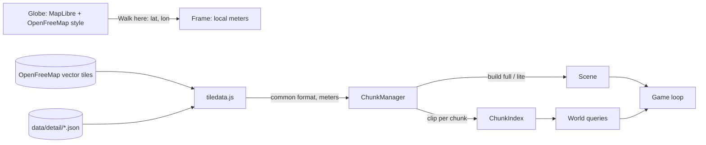

# Architecture

## Overview

Everything runs in the browser. `serve.py` serves static files; it has no data logic.

- **Globe** (`globe.js`): MapLibre GL 5 in globe projection with OpenFreeMap's free "liberty"
  style, the RTL text plugin for Arabic-script labels, Nominatim search and reverse geocoding.
- **Street world** (`main.js` → `chunks.js`): created by `enterStreet(lat, lon, bearing)`, which
  makes a new `Frame` at that point, streams chunks around the player and spawns them on the
  nearest street.

## Coordinates

`Frame` (`geo.js`) puts the origin at the walk-in point: `+x` east, `+z` south, `+y` up, in
meters. Positions come from Web Mercator scaled by `cos(origin latitude)`, accurate to about 1%
within a few kilometers. Walking in somewhere else creates a new frame and a new world.

Two tile zooms matter:

| Zoom | Size (equator / Davis / Paris) | Used for |
| --- | --- | --- |
| 14 (`DATA_ZOOM`) | 2.4 km / 1.9 km / 1.6 km | One download (vector tile or detail file) |
| 16 (`CHUNK_ZOOM`) | 610 m / 480 m / 400 m | One chunk: clipped, indexed, built, dropped as a unit |

## Data sources (`tiledata.js`)

For each z14 tile:

1. If `data/detail/index.json` lists it, load `data/detail/14/x/y.json`: rich OpenStreetMap data
   built by `tools/build_detail.py` (building types, mapped sidewalks and crossings, trees,
   benches, opening hours).
2. Otherwise fetch the OpenFreeMap vector tile (URL template from its TileJSON), decode it with
   `mvt.js` and convert the OpenMapTiles layers with `adaptVector()`.

Both produce the same common format in tile units ([DATA.md](DATA.md)); `toLocal()` converts it
to meters in the current frame. The browser's HTTP cache keeps tiles for revisits.

## Roof colors (`aerial.js`)

For tiles inside the US, the USGS/USDA orthoimagery export for the tile's extent (1024 px,
about 1.5–2.4 m per pixel) is fetched alongside the map data. Each building samples a grid of
pixels inside its footprint, drops shadows and green tree canopy, and keeps the median as its
roof color. Reddish roofs become clay tile; the roof texture is tinted so its average matches
the measured color.

## Tile preparation (`chunks.js: prepareTile`)

Once per z14 tile, in meters:

- **T-junction repair:** a side street's end point that lies on another street's segment is
  inserted into that segment, so intersections can be found by matching coordinates.
- **Road-width fitting:** perpendicular rays from points along each street measure the
  wall-to-wall width; if buildings are closer than the default road width allows, the
  carriageway is narrowed to leave about 2 m of sidewalk on each side.
- **Footway classification** (vector tiles only): footways running alongside a street become
  sidewalks; stretches crossing the asphalt at an angle become crossings.

## Streaming (`ChunkManager`)

Each frame `update(x, z)` re-plans and a single worker loop runs one job at a time, nearest first:

1. **Index** every wanted chunk: clip the tile's data to the chunk rectangle (`clip.js`), build
   a `ChunkIndex` (classified roads with widths, junctions, buildings with zones, areas, places,
   spatial hashes) and register it with `World` and the minimap.
2. **Build full** chunks within `FULL_R` (230 m) and **lite** chunks within `LITE_R` (650 m).
3. **Downgrade** full chunks beyond `DOWN_R` (420 m) to lite; **drop** chunks beyond `DROP_R`
   (900 m), disposing their meshes, indexes, labels and minimap canvases.

Indexing everything first means builds can see neighboring chunks (for example, a building's
nearest street may be across a chunk border). Builds are async and call `budget.tick()` to
yield every ~5 ms, so the game keeps rendering while new areas are built. Rebuilds swap the new
group in only when complete, so there are no holes.

Clipping keeps chunks independent: buildings cut by a chunk edge are drawn in two pieces whose
cut edges (`seam`) get no wall, so they read as one building.

## World model (`world.js`)

`World` holds the loaded `ChunkIndex`es and finds the ones relevant to a query from the chunk
grid. Main queries:

| Method | Answers |
| --- | --- |
| `resolveCircle(x, z, r)` | Pushes a circle out of building/car polygons and round colliders. Used for movement. |
| `groundAt(x, z)` | `0.15` on a raised sidewalk, else `0`. Used for curb stepping. |
| `buildingAt`, `heightAt` | Building under a point and its height. Camera and label occlusion. |
| `nearestRoad`, `onRoad`, `nearPath`, `nearSidewalk` | Street geometry lookups used by builders and HUD. |
| `locate(x, z)` | Street, cross street, and area (named park, OSM neighborhood, or reverse-geocoded name). |

## Builders

- **Streets** (`streets.js`): ground quad, area fills, road ribbons with end caps; in full detail
  also double yellow center lines on two-way major roads, stop lines before intersections,
  crosswalk stripes over asphalt, footpaths, raised sidewalks (mapped ones first; generated
  along streets where none is mapped within 6.5 m), and spots for street trees, tree wells,
  lamps and parked cars. Lite: ground, areas and asphalt only.
- **Buildings** (`buildings.js`): style from OSM type when known, otherwise from places inside,
  landuse zone, footprint size and floor count; height from data or a per-style guess; walls,
  hip roofs on rectangular houses and churches, flat roofs elsewhere; facades with windows,
  doors, storefronts, awnings and cornices; towers get one glass band per floor. Real
  `building:colour` overrides the palette. Lite: walls and roofs only.
- **Props** (`props.js`): instanced trees (mapped, street trees, park scatter), lamps, benches,
  bike racks, hydrants, bins and parked cars with shared geometry and colliders.
- **Labels** (`labels.js`): per chunk; wall signs on street-facing walls, lawn signs for houses,
  post signs for parks and free-standing places, green street-name blades at intersections;
  floating HTML tags with occlusion and declutter; modes tags/signs/off.

## Player, camera and HUD

- Movement relative to the camera (walk 2.2 m/s, run 5.6 m/s, jump), collision via
  `resolveCircle`, curbs via `groundAt`, no world bounds (chunks stream ahead of you).
- Third-person camera with shoulder offset; it pulls in before any wall between head and camera.
- Spawn (`findSpawn`): nearest street to the chosen point → its sidewalk, else the street edge,
  else open ground; facing along the street in the direction closest to the map's bearing.
- HUD: location bar, label mode, info card for the nearest place, rotating minimap, fps,
  credits; the URL hash tracks the current position.

## Materials

`materials.js` builds shared `MeshStandardMaterial`s once: textured ground (asphalt, light
asphalt for lots, concrete sidewalk, pavers, grass, gravel), walls (stucco, siding, two bricks,
concrete, corrugated metal) and roofs (shingles, clay tiles), plus untextured plain, paint, glass
and water. Builders write each surface into a `MultiBuilder`, one merged mesh per material per
chunk; vertex colors tint the textures (paint colors, roof colors). Texture coordinates come from
world position, so textures line up across faces and chunk borders.

## Rendering and performance

One WebGL renderer with ACES tone mapping, an environment map baked from the sky gradient, logarithmic depth, PCF soft shadows from a sun that follows the player
(±60 m), hemisphere light, gradient sky dome, fog from 120 to 620 m and a large ground plane under
everything. Typical cost: 100–200 draw calls (one per material per chunk) and 0.4–1.1M triangles at 60 fps on a
desktop GPU; a z14 tile decodes in 40–140 ms. The three.js loop stops rendering while the globe
is open.
